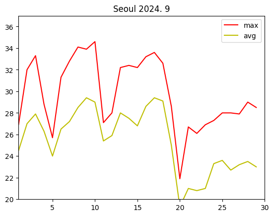
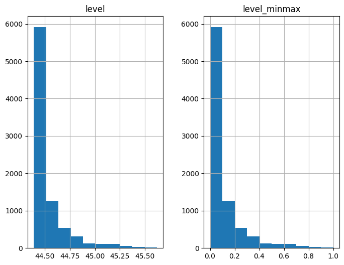
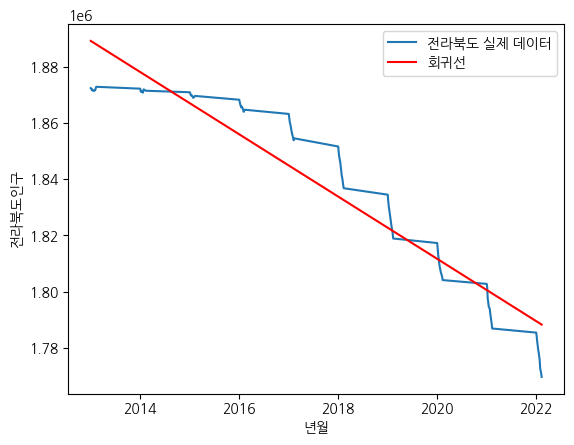
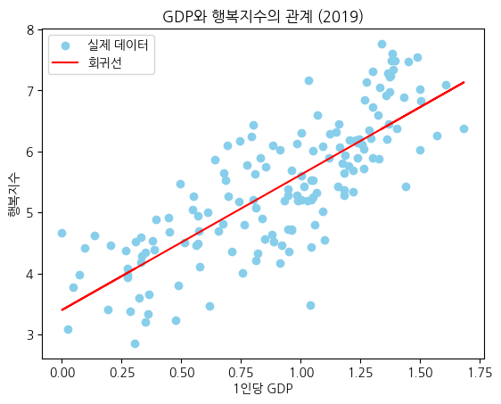

# 🐍 Python 데이터 분석 학습 기록

Python으로 데이터 분석의 기초를 익히며 정리한 **chapter별 실습 노트북** 모음입니다.
pandas·numpy를 이용한 데이터 처리부터 시각화까지, 개념을 직접 코드로 확인하며 학습한 기록입니다.

📅 **학습 기간:** 2025.09 ~ 2025.12 (2학년 2학기)

## 📈 결과 예시

노트북에 저장된 실행 결과 그래프 중 일부입니다.

| | |
| --- | --- |
|  |  |
| **Chapter 6** — 기온 CSV에서 2024년 9월만 골라 서울의 일별 최고·평균 기온을 선 그래프로 비교 | **Chapter 8** — 대전 지하수 데이터의 수위(`level`)를 min-max 정규화하기 전과 후의 분포 비교 |
|  |  |
| **Chapter 10** — 년월별 전라북도 인구에 선형회귀를 적용해 실제 데이터와 회귀선을 함께 표시 | **미니 실습 (World Happiness Report)** — 2019년 국가별 1인당 GDP와 행복지수의 산점도와 회귀선 |

## 📚 다루는 내용

| 영역 | 라이브러리 |
| --- | --- |
| 데이터 핸들링 | `pandas`, `numpy` |
| 시각화 | `matplotlib`, `seaborn` |
| 실행 환경 | Jupyter Notebook |

## 🗂️ 구성

각 노트북(`LHR_Chapter*.ipynb`)은 한 챕터 단위의 실습으로 구성되어 있습니다.

- Chapter 1~5 — 데이터 구조, 인덱싱·선택, 결측치 처리, 기초 통계
- Chapter 6~10 — 그룹 집계, 병합·결합, 시계열, 시각화
- Chapter 11 — 주성분분석(PCA)로 차원 축소

**미니 실습 (공개 데이터셋 적용)**
- `World_Happiness_Report.ipynb` — 세계 행복도 리포트 데이터로 탐색·시각화
- `LHR_titanic_nomissing.csv` — 타이타닉 데이터 결측치 처리 실습 결과

> 학습용 실습 저장소입니다. 개념 정리와 손으로 익히는 과정에 초점을 두었습니다.

## 💡 학습 포인트

직접 코드로 확인하며 익힌 핵심 개념들:

- **결측치 처리** — 단순 삭제 vs 대치(평균·중앙값)의 차이와 데이터 왜곡 가능성
- **그룹 집계(`groupby`)** — 분할-적용-결합 패턴으로 범주별 통계를 한 번에 계산
- **데이터 병합(`merge`/`join`)** — 키 기준 결합과 조인 방식(inner/outer)에 따른 행 수 변화
- **시각화** — `matplotlib`/`seaborn`으로 분포·상관·추세를 눈으로 확인하며 해석

## ▶️ 실행

```bash
pip install pandas numpy matplotlib seaborn jupyter
jupyter notebook
```

원하는 `LHR_Chapter*.ipynb` 파일을 열어 셀을 순서대로 실행하면 됩니다.
